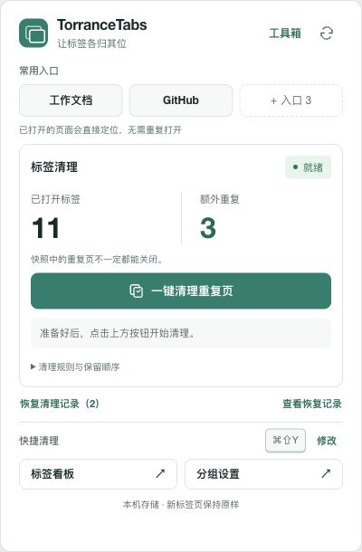

# TorranceTabs

本地优先的 Chrome 标签管理工具，属于 [TorranceKit](https://github.com/TorranceZHANG/TorranceKit) 工具系列，可独立安装和使用。

- **按网址前缀自动分组**：使用 Chrome 原生标签组，最长前缀优先，同窗口复用已有组。
- **一键清理重复标签**：工具栏大按钮、看板主按钮和快捷键共用同一个后台任务；默认按完整网址保留一份，支持按站点忽略指定追踪参数；保护共享、分屏和正在变化的页面。
- **新开重复链接提醒**：网页右上角浮层中选择跳转到已有页面或保留新标签；不另开提示窗口。
- **常用入口**：三个固定槽位，跨窗口定位已打开的页面，或新建并打开；支持快捷键。
- **配置迁移**：导出/导入分组规则、稍后读、常用入口、去重规则和工作区，导入先预览再确认。
- **清理撤销**：恢复工具已记录关闭的网页链接，支持勾选恢复。
- **项目工作区**：保存多个窗口和分组，恢复时复用现有网页，保留新增页面布局。
- **更新助手**：手动检查 GitHub 正式版本并复制更新命令。
- **标签看板**：从工具栏扩展图标打开，支持站点、搜索、跨窗口定位、重复标记和本地稍后读。

TorranceTabs 不接管新标签页；新建标签页继续使用 Chrome 或其他扩展原有的页面。后续版本也保持这一默认行为，标签看板作为手动打开的工具保留。

扩展不调用外部 AI 服务、没有遥测，不读取正文、Cookie 或浏览历史数据库。规则与链接保存在 Chrome 当前用户配置中，详见 [安全说明](SECURITY.md) 和 [功能说明](extension/README.md)。

## 界面

1.7.0 统一了所有扩展页面与提醒的视觉样式：紧凑快捷面板、共享侧栏、清晰的规则表单，以及支持键盘操作的确认框。工具箱的六个功能分区保留原有入口，低频说明可展开查看。



## 一行安装

macOS / Linux 需要 `curl`、Python 3.6+ 和 Chrome 110+；运行扩展无需 Node、Git、TorranceKit Mac App 或后台服务。

```sh
curl -fsSL --connect-timeout 15 --max-time 60 https://raw.githubusercontent.com/TorranceZHANG/TorranceTabs/main/install.sh | sh
```

脚本下载最新正式 Release，校验 SHA-256 和版本，将生产文件放入固定目录：

| 系统 | Chrome 加载目录 |
| --- | --- |
| macOS | `~/Library/Application Support/TorranceTabs/extension` |
| Linux | `${XDG_DATA_HOME:-~/.local/share}/TorranceTabs/extension` |

**脚本完成的是文件安装。首次仍需在 Chrome 中确认加载：**

1. 打开 `chrome://extensions`，开启“开发者模式”。
2. 点击“加载已解压的扩展程序”，选择上表中的 `extension` 目录。Mac 的目录选择窗口可按 `⌘⇧G` 输入完整路径。
3. 在拼图菜单中将 TorranceTabs 固定到工具栏。点击图标可直接清理重复页或进入分组设置。

脚本不会改写 Chrome 配置、注册扩展、开启开发者模式或授予网站权限。这里采用 Chrome 官方的[加载本地扩展方式](https://developer.chrome.com/docs/extensions/get-started/tutorial/hello-world#load-unpacked)。

如需先审阅脚本，再执行：

```sh
curl -fSLo install.sh --connect-timeout 15 --max-time 60 https://raw.githubusercontent.com/TorranceZHANG/TorranceTabs/main/install.sh
sh install.sh
```

指定正式版本：

```sh
sh install.sh --version 1.7.0
```

未找到 Release、下载或校验失败时会明确退出，不会自动切到不断变化的 main 源码构建。固定版本的管理器与同一版本安装包配套使用。SHA-256 用于检查下载完整性，不是独立数字签名。

## 更新

再次执行同一条安装命令，然后在 Chrome 扩展管理页点击 TorranceTabs 的“重新加载”。更新沿用固定路径，旧版本文件保留在同级备份目录；多个安装/卸载进程不会同时修改安装目录。文件替换失败会尝试恢复旧版本，中断后可在下一次安装时恢复完整备份。

更新不会读写 Chrome 中的规则和稍后读，但重新加载会清除未完成的会话内提示。具体行为以 Chrome 对当前扩展身份的管理为准。

从 1.5.0 更新到 1.5.1 或更高版本后，重新加载扩展，再按 `⌘T`（Mac）或 `Ctrl+T`（其他系统）新建标签页，即可使用原有的新标签页。此前已打开的看板不会被自动关闭；仍可点击工具栏扩展图标中的“标签看板”进入。

## 一行卸载

```sh
curl -fsSL --connect-timeout 15 --max-time 60 https://raw.githubusercontent.com/TorranceZHANG/TorranceTabs/main/uninstall.sh | sh
```

脚本将带有项目归属标记的安装目录移到同级可恢复位置，并打印路径，不会永久删除 Chrome 数据。**还需在 `chrome://extensions` 中点击 TorranceTabs 的“移除”**，才会完成浏览器中的卸载。Chrome 移除扩展可能清除它保存的规则和稍后读。

有本地源码时可以离线卸载；预览操作：

```sh
sh uninstall.sh --dry-run
sh uninstall.sh
```

没有项目归属标记、符号链接或异常目录会被拒绝接管。安装锁和历史备份不是 Chrome 扩展本体；卸载后需要彻底清理这些可恢复文件时，请先确认自己不再需要它们，再手动处理脚本打印的准确路径。

## 从旧“前缀分组”迁入

如果此前从其他目录加载过旧扩展，**保留原目录和旧扩展注册，先禁用旧扩展**，再配置新的 TorranceTabs；不要让两套同时运行。切换加载路径不能承诺保持原扩展 ID，因此规则、稍后读与授权不会由这个文件安装器自动迁移。确认新配置正常后，再决定是否移除旧扩展。

本仓库不会自动修改旧版本的安装目录或读取浏览器配置文件。

## 使用提示

在“分组设置”添加例如 `https://github.com/ → 开发` 的规则并保存。要使用网页内重复提醒，需要在设置页明确点击“授权网页内提醒”，批准可选的网站访问权；不授权仍可自动分组和手动去重。

Mac 默认清理快捷键为 **⌘⇧Y**，其他系统为 **Alt+Shift+D**。工具栏面板显示 Chrome 实际绑定，冲突时可能未分配，可点“修改快捷键”调整。去重默认按完整网址比较；工具箱可按精确站点忽略你指定的追踪参数，其他参数及 `#` 仍保留。它不比较页面内容或未保存的表单。

## 工具箱

点击工具栏图标 →“工具箱”，或从设置页、标签看板进入。所有新功能都不接管新标签页。

- **常用入口**：保存三个名称和完整网址，点击后在普通窗口中定位同网址页面，没有才新建。Mac 默认 `Control+Shift+1/2/3`，其他系统 `Alt+Shift+1/2/3`；可在 `chrome://extensions/shortcuts` 调整。原有 `⌘⇧Y` 清理快捷键保留。
- **按站点去重**：例如来源 `https://ata.atatech.org`、参数 `spm`。规则只适用于该精确来源；非指定参数的原始值、编码、顺序、重复参数和 `#` 都保留。工具箱提供两个网址的本地比较预览。清理、网页内重复提醒、看板和快捷面板使用同一判重规则。
- **清理撤销**：先保存恢复记录再关闭；通过快捷面板恢复全部可恢复记录，或到工具箱勾选恢复。恢复原链接并尽可能还原分组，不保证表单、登录状态、滚动位置或页面运行状态。记录保存在本机，最多 500 条、10 批，支持主动清空；跨浏览器会话恢复时使用新普通窗口，不复用旧窗口编号。中断且结果不确定的记录不会自动重试。
- **项目工作区**：保存当前或全部普通窗口的网页、分组、顺序和固定状态。共享、无痕、分屏和内部页面跳过。恢复时已有页面保持原位置，缺少页面才新建并尽可能还原窗口和组；不会关闭任何当前页面。
- **备份迁移**：将 JSON 文件带到另一台机器，选择合并或覆盖，预览冲突后确认。合并保留本机冲突项，只加入缺少的内容；覆盖以备份为准。预览后若其他页面更改数据，需重新预览。授权、临时提示、清理撤销记录不会导出；导入不会自动授予网站权限。备份可能包含内部链接，请自行保管。
- **更新助手**：仅主动点击“检查新版”时请求访问 `https://api.github.com/*` 并查询固定仓库的公开正式版本，不发送标签、标题或配置，不自动下载或执行程序。API 限额时，仅在已有 GitHub 访问权的情况下查询固定仓库发布页；否则提供手动查看入口，不额外申请 github.com 权限。也可直接复制固定的安装命令，更新后在 Chrome 中重新加载扩展。

## 开发与离线安装

开发验证需要 Node 22+、Python 3.6+ 与 make：

```sh
git clone https://github.com/TorranceZHANG/TorranceTabs.git
cd TorranceTabs
make check test
make package
sh install.sh --source .
```

也可把正式 ZIP 和相邻 `.sha256` 文件一起放到本地，再在源码仓库运行：

```sh
sh install.sh --source ./dist/TorranceTabs-v1.7.0.zip --version 1.7.0
```

`extension/` 是浏览器源码和 Node 测试；`scripts/` 是标准库安装器与发布打包器；`tests/` 是安装、校验、恢复和卸载测试。安装器测试使用隔离的临时目录，不操作真实 Chrome。发布包只包含生产扩展、安装管理脚本、版本和许可证，不包含开发测试、对话记录或本机日志。

## 发布

保持 `VERSION`、`extension/manifest.json` 和 `extension/package.json` 的版本一致。通过验证后推送 `v<版本>` 标签，GitHub Actions 会测试并发布 `TorranceTabs-v<版本>.zip` 及相邻 `.sha256` 文件。此仓库的版本与 TorranceKit Mac App 独立。

## 许可证

[MIT](LICENSE)。
